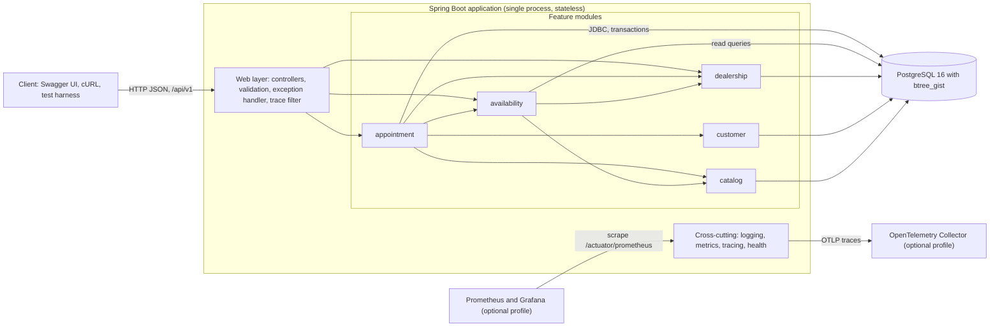
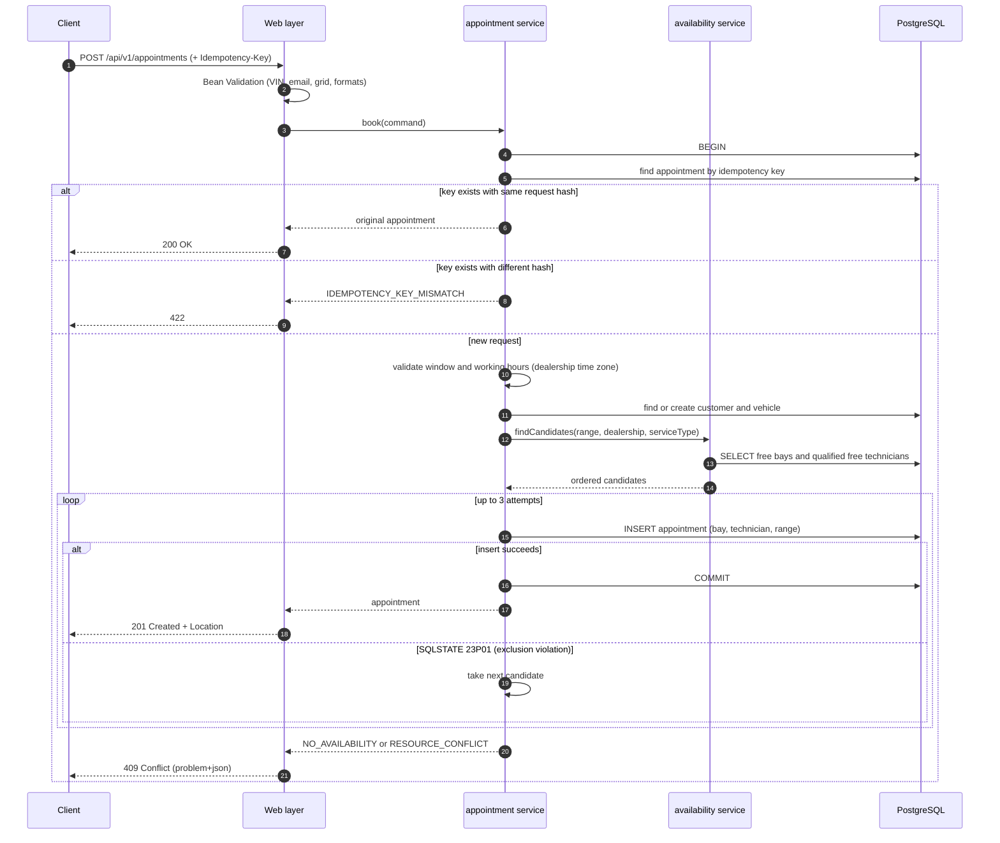
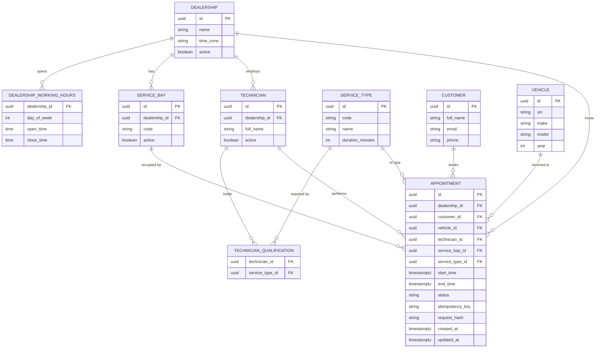
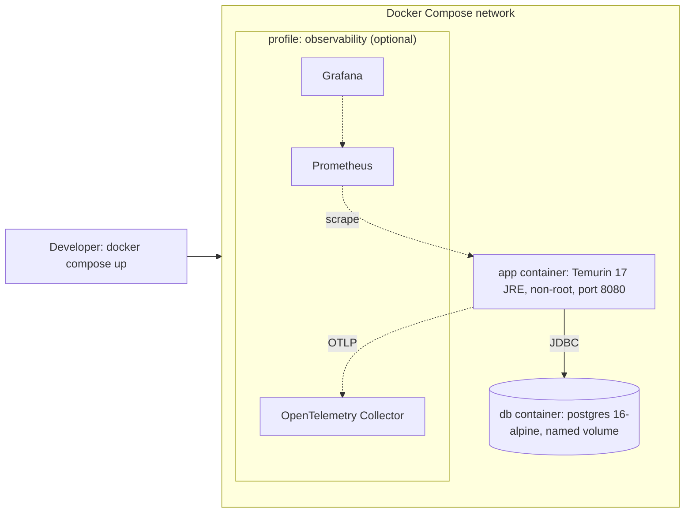

# System Design Document

## Scenario A: The Unified Service Scheduler

Version: 0.1 (draft). Companion document: `docs/requirements/requirements.md` (functional and non-functional requirements, assumptions, ADRs).

---

## Table of Contents

- [1. Introduction](#1-introduction)
- [2. Architecture Overview](#2-architecture-overview)
- [3. Component Descriptions](#3-component-descriptions)
- [4. Data Flow](#4-data-flow)
- [5. Data Model](#5-data-model)
- [6. Consistency and Concurrency Strategy](#6-consistency-and-concurrency-strategy)
- [7. Technology Choices](#7-technology-choices)
- [8. Observability Strategy](#8-observability-strategy)
- [9. Build for the Future](#9-build-for-the-future)
- [10. Deployment](#10-deployment)
- [11. Risks and Future Extensions](#11-risks-and-future-extensions)
- [12. Use of GenAI in the Design Phase](#12-use-of-genai-in-the-design-phase)

---

## 1. Introduction

### 1.1 Purpose

This document describes the architecture of an appointment scheduler that replaces manual booking at automotive dealerships. A user requests a service appointment for a vehicle, a service type, a dealership and a desired time. The system finds a free service bay and a qualified technician for the entire service duration, and persists a confirmed appointment.

### 1.2 Scope

- Chosen layer: **backend** (RESTful API with a persistent PostgreSQL database).
- The client layer is stubbed with Swagger UI, an exported OpenAPI specification and cURL examples in the README.
- Requirements, assumptions and ADRs are in `docs/requirements/requirements.md`. This document references them (FR-x, NFR-x, A-x, ADR-x) and does not repeat them.

### 1.3 Design Drivers

| Driver | Consequence for the design |
|--------|----------------------------|
| No double-booking, even under concurrency (NFR-1) | The database enforces non-overlap with exclusion constraints; the application is never the last line of defense |
| The system, not the user, finds bay and technician (A-2) | An auto-assignment step with a deterministic heuristic |
| Build for the future (scalability, performance, reliability, maintainability, observability) | Stateless application, modular structure, idempotent API, metrics and tracing |
| Reviewers run the project with one command (NFR-6) | Docker Compose with health checks, automatic migrations and seed data |

---

## 2. Architecture Overview

The system is a **modular monolith** (ADR-002): one deployable Spring Boot application, organized into feature modules, backed by one PostgreSQL database.

Module dependency rule: a module may call another module only through its public service interface (verified by an architecture test).

---

## 3. Component Descriptions

| Component | Role |
|-----------|------|
| **Web layer** | REST controllers under `/api/v1`. Bean Validation of request bodies. A global `@RestControllerAdvice` converts exceptions into RFC 9457 Problem Details with a stable `code`. A servlet filter exposes the trace id in the `X-Trace-Id` response header. |
| **appointment module** | Orchestrates booking, cancellation, retrieval and listing. Owns the booking transaction: resolve customer and vehicle, choose resources, insert the appointment, translate constraint violations into domain errors. Handles idempotency (key and request hash). |
| **availability module** | Answers "which bay and which technician are free for this range?" Provides the candidate query used by auto-assignment and the availability endpoint (FR-5). Contains the assignment heuristic (FR-2.4). |
| **dealership module** | Reference data: dealerships, time zones, working hours, service bays, technicians, technician qualifications. Provides working-hours validation in the dealership's local time. |
| **customer module** | Customers (identified by email) and vehicles (identified by VIN). Find-or-create operations that never overwrite existing records (A-13). |
| **catalog module** | Service types and their durations. |
| **PostgreSQL** | System of record. Enforces foreign keys, CHECK constraints, unique keys and the three exclusion constraints that guarantee non-overlapping bookings. |
| **Cross-cutting observability** | Structured JSON logging, Micrometer metrics, OpenTelemetry tracing, Actuator health probes (section 8). |
| **Clock provider** | An injected `Clock` bean so time-dependent rules (lead time, horizon, "already started") can be tested deterministically. |

---

## 4. Data Flow

### 4.1 Create an appointment

Notes:

- The candidate query is an optimization. Correctness comes from the exclusion constraints at insert time (section 6).
- After a failed insert inside a PostgreSQL transaction, the transaction is aborted. The implementation therefore performs each insert attempt in its own short transaction (or uses a savepoint) so that a retry is possible. Customer and vehicle resolution is idempotent, so repeating it is safe.
- When explicit `serviceBayId` or `technicianId` overrides are supplied, validation replaces candidate search for that resource and a conflict returns `RESOURCE_CONFLICT` immediately.

### 4.2 Cancel an appointment

1. `POST /api/v1/appointments/{id}/cancel`.
2. Load the appointment (404 if missing). If already `CANCELLED`, return `200` with the current state (idempotent).
3. If `start_time` is in the past, return `422 APPOINTMENT_NOT_CANCELLABLE`.
4. Set `status = CANCELLED`, `cancelled_at`, `cancellation_reason`, `updated_at`. Resources are freed immediately because the exclusion constraints cover only `CONFIRMED` rows.

### 4.3 Availability query

1. `GET /api/v1/dealerships/{id}/availability?serviceTypeId=...&date=...`.
2. Compute the dealership's working window for that local date, generate 15-minute start times that fit the service duration, and evaluate each against free bays and qualified free technicians in a single set-based query.
3. Return start times in UTC and local time. The result is not a reservation.

---

## 5. Data Model

Full column constraints are in the "Domain Model and Data Constraints" section of `docs/requirements/requirements.md`. Indexes beyond those created by constraints:

| Index | Purpose |
|-------|---------|
| `appointment (dealership_id, start_time)` | List and filter by dealership and date range (FR-4.2) |
| `appointment (vehicle_id)` and `vehicle (vin)` unique | Lookup by VIN |
| `technician_qualification (service_type_id, technician_id)` | Candidate search by service type |
| GiST indexes created by the three exclusion constraints | Overlap checks per bay, technician and vehicle |

---

## 6. Consistency and Concurrency Strategy

The central invariant is: **for any bay, technician or vehicle, no two `CONFIRMED` appointments overlap in time.**

| Layer | Mechanism | Purpose |
|-------|-----------|---------|
| Database | Three exclusion constraints on `tstzrange(start_time, end_time, '[)')` with a partial predicate `status = 'CONFIRMED'` (ADR-003) | Final authority. Holds across any number of application instances |
| Application | Candidate query and deterministic ordering (ADR-009) | Chooses likely-free resources to avoid needless conflicts |
| Application | Bounded retry on SQLSTATE `23P01` (3 attempts) | Absorbs races between two requests that picked the same candidate |
| API | Idempotency key with unique constraint (ADR-010) | Safe client retries |

Error mapping: the constraint name in the PostgreSQL error identifies the resource type (bay, technician, vehicle), which selects the API error code (`RESOURCE_CONFLICT`, `NO_AVAILABILITY` or `VEHICLE_ALREADY_BOOKED`).

Verification: an integration test fires 20 parallel booking requests for the same slot against a real PostgreSQL container and asserts exactly one `201` and nineteen `409` (NFR-1). A second test does the same with auto-assignment and a limited number of resources.

---

## 7. Technology Choices

| Area | Choice | Justification |
|------|--------|---------------|
| Language and runtime | Java 17 (LTS) | Long-term support, modern language features, strong ecosystem |
| Framework | Spring Boot 3.4 or later (ADR-004) | Dependency injection, declarative transactions, Actuator, native structured logging from 3.4 |
| API | Spring Web MVC, Jakarta Bean Validation | Standard, annotation-based validation close to the DTOs |
| API documentation | springdoc-openapi (OpenAPI 3, Swagger UI) | Spec generated from code; serves as the stubbed client contract |
| Database | PostgreSQL 16 with `btree_gist` (ADR-001) | Exclusion constraints and range types give a database-level no-overlap guarantee |
| Persistence | Spring Data JPA (Hibernate) plus native SQL (ADR-005) | Productive CRUD, with native SQL for PostgreSQL-specific queries |
| Migrations | Flyway | Versioned, repeatable schema changes; schema owned by migrations |
| Error format | RFC 9457 Problem Details (ADR-011) | Standard, machine-readable errors |
| Logging | Spring Boot structured logging (ECS) on Logback (ADR-006) | No extra dependency, MDC included automatically |
| Metrics | Micrometer with Prometheus registry | Vendor-neutral metrics, standard Actuator integration |
| Tracing | Micrometer Tracing with OpenTelemetry bridge | W3C trace context, trace id available in logs and responses |
| Testing | JUnit 5, Mockito, Testcontainers, REST Assured or MockMvc, JaCoCo (ADR-012) | Real PostgreSQL in tests; H2 cannot validate exclusion constraints |
| Containers | Docker, Docker Compose (ADR-007) | One-command run with health checks |

---

## 8. Observability Strategy

### 8.1 Logging

- JSON logs in ECS format in the container profile; readable logs in the `local` profile.
- Every line carries `traceId` and `spanId` through the MDC.
- Business events are logged at INFO with identifiers and outcome (`appointmentId`, `dealershipId`, `serviceTypeId`, result code). Conflicts are logged at INFO (an expected outcome), unexpected failures at ERROR with the exception.
- No PII: email, phone and notes are never logged; the VIN is truncated to its last 6 characters.

### 8.2 Metrics

| Metric | Type | Purpose |
|--------|------|---------|
| `http.server.requests` (built in) | Timer | Latency and error rate per endpoint, basis for the p95 target (NFR-2) |
| `appointments_booked_total` | Counter | Business throughput |
| `booking_conflicts_total{reason}` | Counter | Conflict rate by reason (`resource`, `no_availability`, `vehicle`) |
| `booking_assignment_retries_total` | Counter | Contention indicator |
| `booking_duration_seconds` | Timer | End-to-end booking latency |
| HikariCP and JVM metrics (built in) | Gauges | Pool saturation, memory, GC |

Exposed at `/actuator/prometheus`.

### 8.3 Tracing

- Micrometer Tracing with the OpenTelemetry bridge creates a span per request and per database call.
- The `traceparent` header is accepted and propagated, so the scheduler can join a larger trace.
- Traces are exported over OTLP to an OpenTelemetry Collector when the `observability` Compose profile is enabled.
- The trace id is returned in `X-Trace-Id` and in the `traceId` member of every error response, so a client-reported error can be located in logs and traces.

### 8.4 Health

- `/actuator/health/liveness` and `/actuator/health/readiness` (readiness includes the database).
- Used by Docker Compose health checks and suitable for Kubernetes probes.

---

## 9. Build for the Future

| Quality | Design response |
|---------|-----------------|
| Scalability | The application is stateless; scale out by adding instances behind a load balancer. All coordination is in PostgreSQL. Reads can move to replicas later. `appointment` can be partitioned by `start_time` if volume grows. Availability results could be cached, with the database constraints still protecting correctness. |
| Performance | Set-based candidate query using GiST and B-tree indexes; bounded page sizes; no `open-in-view`; connection pool sized for the target concurrency; p95 target and load script (NFR-2). |
| Reliability | Idempotent booking; bounded retry on exclusion violation; statement and connection timeouts; graceful shutdown; atomic booking transaction; health probes. |
| Maintainability | Package-by-feature modules with enforced dependency rules; Flyway-owned schema; Problem Details contract; formatter and static checks; tests at three levels. |
| Observability | Section 8. |
| Extensibility | Domain events (for example "appointment confirmed") can later feed a notification consumer without changing the booking logic. Modules can be extracted into services along their existing boundaries. |

---

## 10. Deployment

- `app` starts only after `db` reports healthy (`pg_isready`).
- Flyway applies migrations and seed data on startup; the seed includes dealerships with time zones and working hours, bays, technicians, service types and qualifications.
- Configuration comes from environment variables (`.env.example` provided). The same image can run on any container platform.

---

## 11. Risks and Future Extensions

| Risk | Mitigation |
|------|-----------|
| High contention on popular slots causes retries and `409` | Retry limit with metric `booking_assignment_retries_total`; possible future `FOR UPDATE SKIP LOCKED` on candidates |
| Heuristic assignment may not maximize utilization | Documented limitation; solver-based assignment is out of scope |
| Daylight saving transitions around working hours | All local-time evaluation uses `java.time.ZonedDateTime`; dedicated tests for transition dates |
| PostgreSQL-specific features reduce portability | Accepted trade-off (ADR-001); isolated to migrations and a few native queries |
| `@Transactional` proxy pitfalls (self-invocation) | Booking logic placed in a dedicated service bean; integration tests cover rollback behavior |

Future extensions (see Out of Scope in `docs/requirements/requirements.md`): authentication, notifications, rescheduling, technician shifts and holidays, recurring appointments, caching, rate limiting, an AI assistant for availability lookup.

---

## 12. Use of GenAI in the Design Phase
### 12.1 Tools and roles

| Tool | Used for |
|------|----------|
| Claude (chat) | Reviewing my requirements against the brief, challenging assumptions, drafting ADRs and this document |
| Antigravity (ide) | [Planned: implementation] |

### 12.2 Process

1. **Brief analysis.** I extracted the explicit requirements and ambiguities from the brief myself, separating "what the brief states" from "my interpretation".
2. **First requirements draft.** I wrote functional requirements, non-functional requirements, assumptions, out-of-scope items and ADRs for Spring Boot and PostgreSQL.
3. **AI-assisted review.** I asked Claude to compare my draft with the brief and to list mismatches, vague points and improvements. Findings included:
   - The assumption that users pick the bay and technician contradicted the brief, where the system performs that check.
   - The exclusion constraint design lacked a status predicate, so cancelled appointments would still block slots.
   - A single constraint could not cover both bay and technician, and the vehicle was not protected from overlapping bookings.
   - Parts of ADR-004 and ADR-006 referenced another stack (NestJS decorators, Pino).
   - A statement about MongoDB transactions was outdated.
4. **Verification.** [Describe how you checked each AI finding: for example, read the PostgreSQL documentation on exclusion constraints and range types, checked the Spring Boot reference for structured logging support in 3.4, checked the MongoDB manual for transaction support.]
5. **Decisions I made.**  booking window, retry count, idempotency key optionality, cancel endpoint style.
6. **What I rejected or changed.** [Add concrete examples of AI suggestions you did not accept and why. Reviewers value this.]

### 12.3 Ownership

[Explain, in your own words, the three parts you can defend without notes: why three exclusion constraints with a partial predicate, why 15-minute grid with dealership time zone, and why retry on `23P01` is safe.]